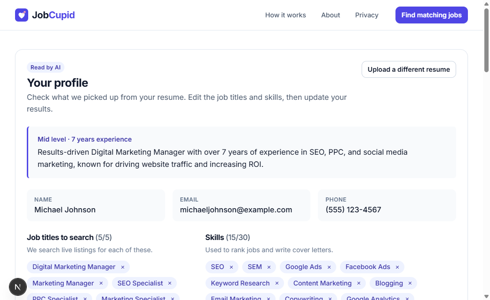
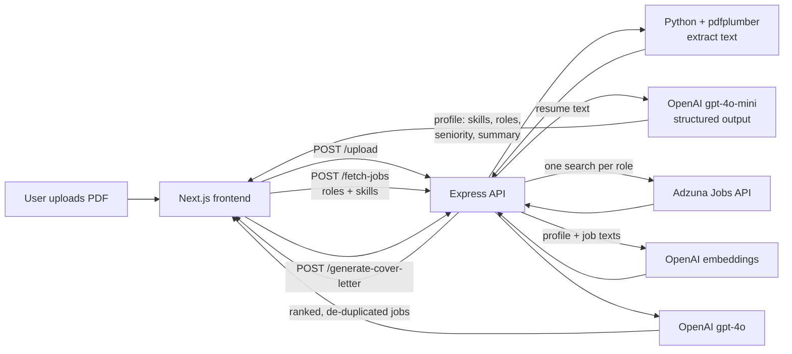

# JobCupid

**Upload your resume once and get a ranked list of live jobs that actually fit you.**

JobCupid is a full-stack web app that reads a PDF resume with AI, works out the candidate's skills, seniority and the job titles that suit them, searches live job listings in Singapore, and ranks every result by how well it matches the candidate's profile. It can also draft a tailored cover letter for any job in one click.

It started as a hackathon project built around one idea: job seekers shouldn't spend hours scrolling through listings to find the few they're qualified for. I've since rebuilt it into a production-style app with AI resume analysis, semantic job ranking, a redesigned interface, and hardened backend.



---

## Features

- **AI resume analysis.** An LLM reads the resume and returns a structured profile: name, contact details, a short professional summary, seniority, years of experience, up to 30 skills and 3–5 job titles the candidate is a realistic fit for.
- **Live job search.** Searches [Adzuna](https://www.adzuna.sg) for each suggested job title in parallel and removes duplicate listings.
- **Semantic ranking.** Every job gets a 0–100 match score that combines meaning-based similarity (OpenAI embeddings) with whole-word skill matches, plus a label (Strong, Good, Fair, Weak) and the skills it mentions.
- **Editable search.** Users can remove or add job titles and skills, then re-run the search, so they stay in control when the AI gets something wrong.
- **AI cover letters.** Generates a cover letter tailored to the job description and the candidate's profile, with copy and download options.
- **Clear states everywhere.** Loading skeletons, empty states, and friendly error messages with retry, so the user never sees a blank screen.
- **Accessible and responsive.** Mobile-first layout, keyboard navigation, visible focus states, a skip link, screen-reader announcements and a native modal dialog.

## How it works



1. **Upload.** The user uploads a PDF (max 2MB). The server checks the file type, size and PDF signature.
2. **Extract text.** A small Python script extracts the text with `pdfplumber`. The uploaded file is deleted immediately afterwards, including when something fails.
3. **Build a profile.** The text is sent to OpenAI with a strict JSON schema (structured outputs), so the response always has the same shape. The server then validates and cleans it: trims values, removes duplicates and caps list sizes. The prompt tells the model to treat the resume as untrusted data and ignore any instructions inside it.
4. **Search.** The backend runs one Adzuna search per job title (up to 5, in parallel) and removes duplicates by listing ID and by normalised title plus company.
5. **Rank.** The profile and every job's title and description are embedded in a single batch request. Each job's score is:

   | Component | Weight | How it's measured |
   |---|---|---|
   | Semantic similarity | 70% | Cosine similarity between the profile embedding and the job embedding, scaled to 0–1 |
   | Skill overlap | 30% | Number of the user's skills found in the listing as whole words (5 or more = full marks) |

   Whole-word matching handles skills with symbols such as `C++`, `C#` and `Node.js`, and avoids false positives like "Git" inside "Digital".
6. **Review and refine.** Results are shown 9 per page, best match first. The user can edit job titles and skills and click **Update results** to search again.
7. **Cover letter.** For any job, the backend sends the candidate's profile and the job description to OpenAI and returns a letter with today's date and no placeholders.

## Tech stack

| Layer | Technology |
|---|---|
| Frontend | Next.js 15 (pages router), React 19, CSS Modules with a custom design system, Axios |
| Backend | Node.js, Express, Multer (uploads), express-rate-limit, CORS |
| Resume text extraction | Python 3, pdfplumber |
| AI | OpenAI Chat Completions with structured outputs (`gpt-4o-mini`), Embeddings (`text-embedding-3-small`), `gpt-4o` for cover letters |
| Job data | Adzuna Jobs API |

## Project structure

```
JobCupid/
├── backend/
│   ├── server.js              # Express API: routes, validation, rate limits, CORS
│   ├── lib/
│   │   ├── openai.js          # Resume → profile, embeddings, cover letters
│   │   └── jobs.js            # Adzuna search, de-duplication, ranking
│   ├── resume_parser/
│   │   ├── parser.py          # PDF → text
│   │   └── requirements.txt
│   └── .env.example
├── frontend/
│   ├── pages/                 # index (home), match (the app), 404
│   ├── components/
│   │   ├── layout/            # Navbar, Footer, Logo, Layout
│   │   ├── match/             # Upload, profile editor, job cards, pagination, cover letter dialog
│   │   └── Seo.js             # Page titles, descriptions, Open Graph tags
│   ├── lib/                   # API client, site config
│   ├── styles/globals.css     # Design tokens, buttons, cards, utilities
│   └── .env.example
└── docs/screenshots/
```

## Getting started

### Prerequisites

- [Node.js](https://nodejs.org/) 18 or newer
- [Python](https://www.python.org/) 3.9 or newer
- An [OpenAI API key](https://platform.openai.com/api-keys)
- An [Adzuna API app ID and key](https://developer.adzuna.com/) (free)

### 1. Install

```bash
git clone https://github.com/shxnzzz/JobCupid-.git
cd JobCupid-

# Backend
cd backend
npm install
pip install -r resume_parser/requirements.txt

# Frontend
cd ../frontend
npm install
```

### 2. Configure environment variables

```bash
# from the project root
cp backend/.env.example backend/.env
cp frontend/.env.example frontend/.env.local
```

On Windows PowerShell, use `copy` instead of `cp`. Then fill in your keys in `backend/.env`.

**Backend (`backend/.env`)**

| Variable | Required | Default | Description |
|---|---|---|---|
| `OPENAI_API_KEY` | Yes | | Used for resume analysis, ranking and cover letters |
| `ADZUNA_API_ID` | Yes | | Adzuna app ID |
| `ADZUNA_API_KEY` | Yes | | Adzuna app key |
| `FRONTEND_ORIGIN` | No | `http://localhost:3000` | Allowed frontend origin(s) for CORS, comma-separated |
| `PORT` | No | `5000` | API port |
| `PYTHON_PATH` | No | `python` | Python executable (e.g. `python3` or a virtualenv path) |
| `ADZUNA_COUNTRY` | No | `sg` | Adzuna country code |
| `OPENAI_MODEL` | No | `gpt-4o-mini` | Model for resume analysis |
| `OPENAI_COVER_LETTER_MODEL` | No | `gpt-4o` | Model for cover letters |
| `OPENAI_EMBEDDING_MODEL` | No | `text-embedding-3-small` | Model for ranking |
| `TRUST_PROXY` | No | | Set to `1` when deployed behind a proxy so rate limits see real client IPs |

**Frontend (`frontend/.env.local`)**

| Variable | Default | Description |
|---|---|---|
| `NEXT_PUBLIC_API_URL` | `http://localhost:5000` | Backend URL |
| `NEXT_PUBLIC_SITE_URL` | `http://localhost:3000` | Public site URL, used for canonical and social sharing tags |

### 3. Run

Use two terminals.

```bash
# Terminal 1 — backend
cd backend
node server.js
# → Server running on http://localhost:5000
```

```bash
# Terminal 2 — frontend
cd frontend
npm run dev
# → Local: http://localhost:3000
```

Open **http://localhost:3000**. A sample resume is included at `backend/resume_parser/Test Resume.pdf`.

> **Tip:** open the site at exactly `http://localhost:3000`. The backend only accepts requests from the origins in `FRONTEND_ORIGIN`, so `127.0.0.1:3000`, the "Network" address or port `3001` will be blocked unless you add them.

## API

| Method | Endpoint | Body | Returns |
|---|---|---|---|
| `POST` | `/upload` | `multipart/form-data` with a `resume` PDF | Profile: `name`, `email`, `phone`, `summary`, `seniority`, `yearsExperience`, `skills[]`, `roles[]` |
| `POST` | `/fetch-jobs` | `{ roles[], skills[], summary }` | `{ jobs[] }` sorted by `matchScore`, each with `matchedSkills`, `snippet`, salary and posting date |
| `POST` | `/generate-cover-letter` | Profile fields, `skills[]`, `jobTitle`, `company`, `jobDescription` | `{ coverLetter }` |
| `GET` | `/health` | | `{ status: "ok" }` |

Errors are always returned as JSON (`{ "error": "..." }`) with an appropriate status code, and never include stack traces.

## Privacy and security

- **Resumes aren't stored.** Uploaded files are deleted as soon as the text is extracted, and any leftovers are cleared when the server starts. Resume text is held only in memory for the duration of the request.
- **Third parties.** Resume text is sent to OpenAI to build the profile. Job listings come from Adzuna. Users are told this in a consent note before uploading.
- **Upload validation.** PDF only, checked by MIME type, file extension and file signature, with a 2MB limit. Text is extracted with `execFile` (no shell) and a timeout.
- **Abuse protection.** Rate limits per IP on every AI-backed endpoint, CORS restricted to the frontend origin, JSON body size limits.
- **Secrets.** All API keys live in `.env` files that are git-ignored. `.env.example` files document what's needed.

## Known limitations

- **Singapore only.** Searches use Adzuna's Singapore index. Other countries are a config change (`ADZUNA_COUNTRY`), but the copy and salary handling assume Singapore.
- **Text-based PDFs only.** Scanned or image-only resumes can't be read. No OCR yet.
- **AI can make mistakes.** The profile can miss or misjudge skills, which is why users can edit it before searching. Cover letters are labelled as AI-written and should be reviewed.
- **Match scores are estimates.** The semantic score thresholds were calibrated on a small set of test searches.
- **Salary data quirk.** Adzuna's API sometimes reports salaries written as "90k" as 90 × 12 = 1,080. JobCupid detects this pattern and recovers the intended figure, and hides other implausible values, but some listings may still be off.
- **Limited results.** Up to 20 listings per job title (about 100 before de-duplication).

## Roadmap

- [ ] Marketing landing page, About, Privacy Policy and Terms pages
- [ ] Deploy (frontend on Vercel, backend with a Dockerfile on Render or Railway)
- [ ] Automated tests for the ranking, salary normalisation and API validation
- [ ] OCR support for scanned resumes
- [ ] Filters (salary, location, posted date) and saved jobs
- [ ] Support more countries

## Background

JobCupid began as a hackathon project. The first version matched resumes against a fixed list of about 250 skills using spaCy, searched once per skill, and ranked jobs by whether a skill appeared anywhere in the job title. Rebuilding it meant replacing that with LLM-based resume analysis and embedding-based ranking, cutting job searches per upload from as many as 29 to at most 5, and adding de-duplication, input validation, rate limiting, and a redesigned, accessible interface.
